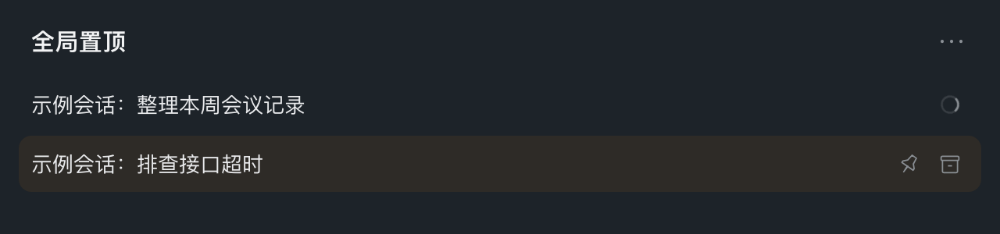

# Global pinned conversations

会话散落在不同工作区，重要内容不好找？全局置顶把你选中的会话集中到侧边栏顶部，支持拖拽排序和清晰的插入位置提示，也可按最近更新时间自动排序。顶部放大镜可以按会话名称、工作区或消息内容搜索全部会话。会话完成后，小绿点提醒你查看。



A running conversation shows only the spinning ring until the row is hovered or focused; pin and archive then take its place in the same slot. This illustration is a synthetic mock rendered from the plugin's own styling, not a screenshot of real conversations.

A standalone DSH bundle for the `sidebar.workspaces` public slot. It replaces that browsing region at priority -100 (this Harness version selects the lowest numeric priority); it does not modify Harness files or import internal Client modules. Disable the bundle to restore the shipped browser.

## Install

Install the prebuilt release in DeepSeek Harness using this package URL:

```text
https://github.com/tao1020/dsh-global-pins/releases/download/v1.0.6/local-global-pins-1.0.6.tgz
```

Or with the Harness CLI:

```sh
dsh plugin add https://github.com/tao1020/dsh-global-pins/releases/download/v1.0.6/local-global-pins-1.0.6.tgz
```

Tested with DeepSeek Harness `0.2.1-rc.5`. No build step or npm account is required. The package keeps its original `@local/global-pins` identity so existing local installations update rather than install a second copy.

## Behavior

- Pins use the existing Host workspace pin registry, shared across workspaces. Workspace membership is never rewritten.
- Pinned rows appear once in the global section. Unpin returns a conversation to its original workspace and preserves its saved group position.
- Last updated uses the same Client summary `updatedAt` value as the original browser. Manual order is stored in this browser under `local.global-pins.v1`.
- Drag a conversation into the pin section to pin it. Drag within a section to reorder and switch to manual mode. A highlighted line and dot show the insertion point above/below a row or at the section end. Invalid or unchanged positions show no marker. Drag a pin back onto its own workspace to unpin and insert at the indicated position; the ordinary unpin button still restores the saved group position. Cross-workspace moves are rejected.
- The pinned heading's ellipsis opens Manual / Last updated options, with a check beside the current mode. Selecting an option, leaving the control, or pressing Escape closes the popup. Selecting the current mode preserves its order.
- New pins lead existing manual pins. Switching to recent clears saved manual layout; switching back freezes the currently visible chronology, including hidden archive positions.
- Right-click a conversation, or press Shift+F10 / the context-menu key while its title is focused, to open the owned action menu: rename, fork, archive/restore, and move up/down. Arrow keys/Home/End navigate; Escape closes and restores focus to the title, and leaving the menu dismisses it. Rows no longer carry a per-row ellipsis button, so the trailing edge only holds real actions.
- Session rename replaces the title in that same row. Opening the editor focuses the input with the whole title selected, so typing replaces it directly. Enter saves; Escape cancels. Composition input does not accidentally save/cancel. Empty names are rejected; failed saves keep the draft for retry; pending requests cannot duplicate. The input retains its native text-edit context menu. Workspace rename and Add workspace keep their separate forms.
- Pin and archive actions sit on the right with native 14px SVG artwork and 24px button targets; while a conversation is running they appear once the row is hovered or focused. Hover highlights the full conversation row, not only its title. Workspace rows support new sessions and rename. Add workspace accepts an existing absolute directory path.
- The magnifier beside the "Global pins" heading opens a search overlay. It searches conversation titles and workspace names locally, then the Host's visible message-content index. Title matches come first in last-updated order, content-only matches follow with a snippet, and duplicates appear once. Results are split by small "Sessions"/"Content" headings and use the Host search limit (20 today) and show a "narrow your search" note when either the Host or the local list holds more. The phrase is trimmed, stripped of NUL and clamped to 500 UTF-16 units without splitting an emoji. Typing is debounced by 250ms and superseded or closed requests are aborted. Up/Down select, Enter opens the highlighted conversation and closes the overlay, Escape closes and returns focus to the magnifier, and Tab stays inside the dialog. Archived conversations and blank drafts are excluded; workspace labels appear on each result. Real Host failures are reported; a deployment that disables the content index is explained as a short note while name matches stay usable.
- A target button beside the magnifier jumps to the current session: it expands that session's workspace when needed, reveals archived rows when required, scrolls the row into view and flashes it briefly. Conversation rows use 13px text on 32px tracks, and every section heading (Global pins and each workspace name) sits on a translucent grey band, so sections read as separate areas without tinting the conversation rows themselves.
- Conversations touched today that are not pinned collect in a "Recent" section directly under the global pins, newest first, no matter which workspace created them. The section refreshes at local midnight and whenever the window becomes visible again, so yesterday's conversations drop back into their own workspace unless they were pinned. A conversation created earlier but used today also counts as recent, because Harness only exposes `updatedAt` to plugins. Rows in this section cannot be dragged or moved up/down; rename, fork, archive and pin still work. Pinned, archived and blank conversations never appear there.
- The "Global pins" heading carries the same left fold triangle as workspace headings, so the whole pinned block can be collapsed while its magnifier, target and menu stay reachable. Collapsed sections keep only a small gap, and folding keeps the clicked heading at the same screen position instead of letting the list jump back to the top.
- A running conversation shows a continuously animated spinning ring at the row's right. The ring replaces the old "◌" glyph before the title and keeps a fixed 48px slot, so the title never jumps when pin/archive swap in on hover or keyboard focus. Reduced-motion users get the static arc instead of rotation; the ring has an English/Chinese accessible label.
- Pinned and ordinary rows show a small green completion-unread dot on the right, using the native `useSessionStatus` snapshot and theme token. The dot has an English/Chinese accessible label. Running takes priority; archived and blank rows never show completion dots. Native status overrides the summary's running flag when present, including explicit `false`; otherwise the summary remains the fallback. Harness owns unread tracking and acknowledgement when opening a session; the plugin does not keep a separate unread registry.

## Compatibility limits

This is a replacement browser, not a wrapper around private components. It does not preserve the native search dialog (its filter tabs, saved searches and result grouping), workspace tree mode, child-activity/scheduled-task indicators, approval/question status badges, directory-picker dialogs, per-workspace show-more watermarks, custom row slots, or stop-and-archive confirmation. Running-session archive refusal is displayed; work is not stopped automatically. Workspace removal is not provided. Saved view layout is browser-local, not synced between devices; storage events synchronize other tabs of the same origin. Host authorization remains authoritative.

Live Client Inspect confirms the plugin owns the sidebar slot, and the user confirmed the pinned section is visible and pinning/dragging work. The agent could not independently inspect screenshots or drive the desktop UI: the browser entry requires authentication and native accessibility permission is unavailable. Unit tests are not a substitute for full end-to-end visual coverage.

## Development checks

```sh
node --check client.js
npm test
npx --yes prettier@3.6.2 --check client.js index.js test/*.test.js package.json locale/en.json locale/zh.json
```

The 71 regression tests cover ordering/partition helpers, Host delegation/validation, and Browser hook/event behavior using a small VM harness (46 tests). Existing sorting, drag/storage races, and unread status checks remain. New checks execute the registered `apply`/slot `inject` API with scoped injection enforcement for both `remote` and `remote.session`; cover same-row rename, success/refusal/rejection/retry, pending duplicates, empty input, composition, cancellation and focus; assert the rename editor's mount ref focuses then selects the whole title and keeps its identity across typing; verify the running spinner markup, localization and hover/focus reveal CSS; assert rows expose no ellipsis while the right-click menu still lists every action; exercise the search overlay (debounce and abort wiring, local-first merge order under small group headings, snippet rendering, Enter open, Escape focus restore, error/empty states, a disabled content index that keeps name matches and explains itself, archived exclusion, trigger disabled during rename); check that the locator enables only with a current session, expands a folded workspace and marks the row; assert the compact row scale and the translucent section-header band; verify the recent section holds only today's unpinned rows in newest-first order, keeps pinned/archived/blank rows out, drops older rows back into their workspace and marks recent rows as fixed (no drag, no move actions); assert the pinned heading folds its rows while keeping its tools, the compact spacing rules, and local-calendar day bucketing; and check native icon dimensions and full-row hover CSS. These are hook/event and CSS-contract tests, not actual DOM layout or desktop interaction. Native unread lifecycle, real animation/paint, focus/IME behavior, and menu positioning/clipping still need end-to-end visual checks. This patch was not independently desktop-validated.

The bundle logo is original artwork. Row pin icons match the shipped Harness outline/filled pin paths. No runtime dependencies or install scripts are required.
